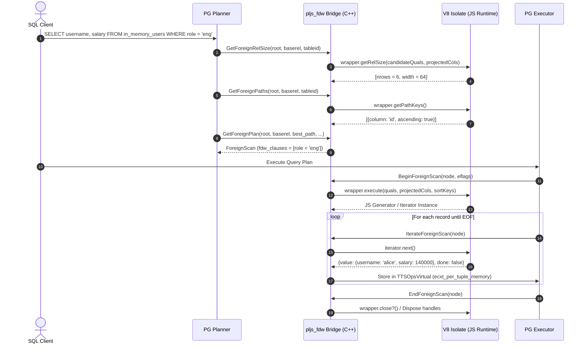
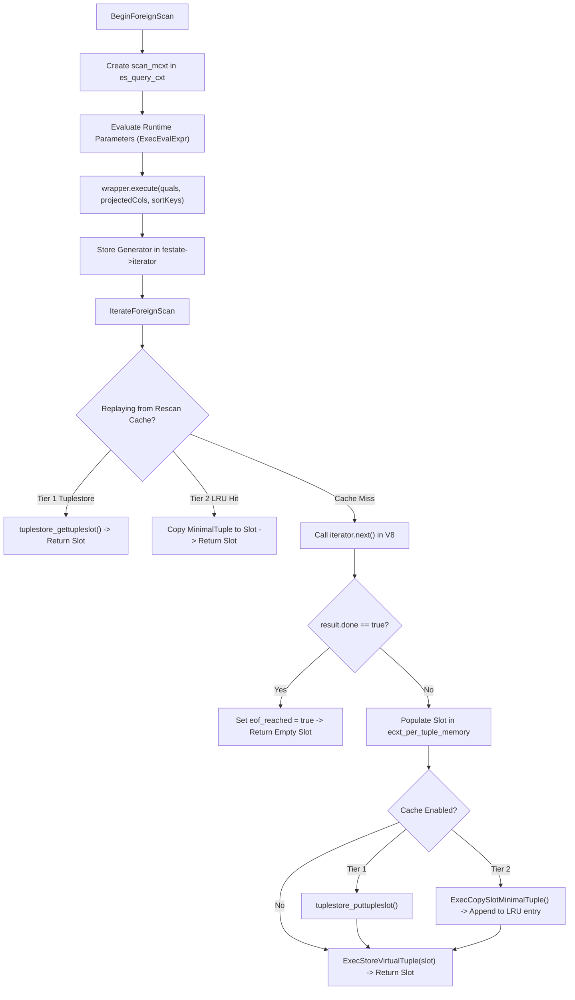

# PL/JS Foreign Data Wrapper (`pljs_fdw`) Implementation Walkthrough

## 1. Overview & Architecture

The **`pljs_fdw`** implementation bridges PostgreSQL's SQL/MED engine (`FdwRoutine`) with Google V8's high-performance JIT execution environment. This walkthrough details the end-to-end data flow, execution lifecycles, and internal algorithms implemented across `src/fdw.h` and `src/fdw.c`.



---

## 2. Component Breakdown

### 2.1 The Handler & Routine Initializer (`pljs_fdw_handler`)

When PostgreSQL queries a foreign table managed by `pljs_fdw`, the engine invokes `pljs_fdw_handler()`:

```cpp
PGDLLEXPORT Datum pljs_fdw_handler(PG_FUNCTION_ARGS) {
  FdwRoutine *routine = makeNode(FdwRoutine);

  // Planning callbacks
  routine->GetForeignRelSize = pljs_fdw_get_foreign_rel_size;
  routine->GetForeignPaths = pljs_fdw_get_foreign_paths;
  routine->GetForeignPlan = pljs_fdw_get_foreign_plan;

  // Scanning callbacks
  routine->BeginForeignScan = pljs_fdw_begin_foreign_scan;
  routine->IterateForeignScan = pljs_fdw_iterate_foreign_scan;
  routine->ReScanForeignScan = pljs_fdw_rescan_foreign_scan;
  routine->EndForeignScan = pljs_fdw_end_foreign_scan;

  // DML write callbacks
  routine->AddForeignUpdateTargets = pljs_fdw_add_foreign_update_targets;
  routine->PlanForeignModify = pljs_fdw_plan_foreign_modify;
  routine->BeginForeignModify = pljs_fdw_begin_foreign_modify;
  routine->ExecForeignInsert = pljs_fdw_exec_foreign_insert;
  routine->ExecForeignBatchInsert = pljs_fdw_exec_foreign_batch_insert;
  routine->GetForeignModifyBatchSize = pljs_fdw_get_foreign_modify_batch_size;
  routine->ExecForeignUpdate = pljs_fdw_exec_foreign_update;
  routine->ExecForeignDelete = pljs_fdw_exec_foreign_delete;
  routine->EndForeignModify = pljs_fdw_end_foreign_modify;
  routine->IsForeignRelUpdatable = pljs_fdw_is_foreign_rel_updatable;

  // Direct modify pushdown
  routine->PlanDirectModify = pljs_fdw_plan_direct_modify;
  routine->BeginDirectModify = pljs_fdw_begin_direct_modify;
  routine->IterateDirectModify = pljs_fdw_iterate_direct_modify;
  routine->EndDirectModify = pljs_fdw_end_direct_modify;

  // Diagnostics & Sampling
  routine->ExplainForeignScan = pljs_fdw_explain_foreign_scan;
  routine->AnalyzeForeignTable = pljs_fdw_analyze_foreign_table;
  routine->ImportForeignSchema = pljs_fdw_import_foreign_schema;

  PG_RETURN_POINTER(routine);
}
```

By initializing with `makeNode(FdwRoutine)`, any unassigned callback pointers default to `NULL`.

---

### 2.2 Relational Planning & Predicate Pushdown

#### Step 1: Option Resolution & Wrapper Lookup
In `GetForeignRelSize`, `pljs_fdw` calls `GetForeignTable(foreigntableid)` and `GetForeignServer(table->serverid)`. Options are resolved into a key-value dictionary. The `wrapper` option specifies which JavaScript class to instantiate.

#### Step 2: Pushdown Analysis (`canPushdown`)
The bridge iterates `baserel->baserestrictinfo`:
1. **Binary Operators (`OpExpr`)**: Checks if one operand is a column `Var` belonging to the foreign relation and the other is an evaluatable constant or parameter. If the expression is written in reverse (`'constant' = column`), `get_commutator(opno)` is called to invert the operator and guarantee that `field` is always the column name.
2. **ScalarArrayOpExpr**: Translates `col = ANY(ARRAY[1, 2, 3])` to `operator: 'IN'` with an array value.
3. **NullTest**: Translates `col IS NULL` and `col IS NOT NULL` to `operator: 'IS'` with values `null` and `'NOT NULL'`.
4. **JavaScript Capability Check**: Each candidate qual is passed to `wrapper.canPushdown(qual)`. If the wrapper returns `true`, the clause is added to `fdw_clauses` and removed from PostgreSQL's local filter list (`foreign_scan->scan.plan.qual`).

#### Step 3: Path Generation (`GetForeignPaths`)
- Queries `wrapper.getPathKeys()` to determine if data is pre-sorted. If pre-sorted keys match the query's `ORDER BY` pathkeys, a `ForeignPath` with those pathkeys is registered via `add_path()`. This allows PostgreSQL's optimizer to bypass expensive `Sort` plan nodes.
- If parameterized join clauses exist (`baserel->joininfo`), parameterized foreign paths are created with `ppi_req_outer` to enable nested loop join pushdown.

---

### 2.3 Foreign Scan Execution & Zero-Copy Slot Streaming



#### Detailed Execution Sequence:
1. **Memory Context Isolation**: All persistent scan state and cache buffers are allocated in `scan_mcxt` (a child of `node->ss.ps.state->es_query_cxt`).
2. **Virtual Tuple Population (`ecxt_per_tuple_memory`)**:
   - `MemoryContextSwitchTo(econtext->ecxt_per_tuple_memory)`.
   - Attributes requested by `projected_attrs` are extracted from the JavaScript record.
   - For string, numeric, and jsonb data, `pljs_type::ToDatum()` allocates PostgreSQL varlena headers and byte buffers directly in `ecxt_per_tuple_memory`.
   - `ExecStoreVirtualTuple(slot)` marks the slot valid.
3. **Automatic Cleanup**: When upper plan nodes finish processing the tuple, `ResetExprContext()` instantaneously reclaims `ecxt_per_tuple_memory` without traversing or freeing individual Datums.

---

### 2.4 Rescan & Parameterized Tuple Caching

In nested loop joins, the inner scan is rescanned repeatedly:

```cpp
void pljs_fdw_rescan_foreign_scan(ForeignScanState *node) {
  PljsFdwScanState *festate = (PljsFdwScanState *) node->fdw_state;
  festate->eof_reached = false;

  // Tier 1: Unparameterized scan -> Rewind Tuplestore directly
  if (!festate->is_parameterized && festate->unparam_cache_complete) {
    tuplestore_rescan(festate->unparam_tuplestore);
    festate->stats_cache_hits++;
    return;
  }

  // Tier 2: Parameterized scan -> Evaluate runtime parameter hash
  uint64 param_hash = EvaluateParamHash(festate, node);
  festate->current_param_hash = param_hash;

  if (festate->cache_enabled) {
    auto it = festate->param_cache.find(param_hash);
    if (it != festate->param_cache.end()) {
      // Cache Hit: Replay from in-memory MinimalTuples
      festate->replaying_from_cache = true;
      festate->cached_tuple_cursor = 0;
      TouchLruEntry(festate, param_hash);
      festate->stats_cache_hits++;
      return;
    }
  }

  // Cache Miss: Re-execute JavaScript generator with updated parameters
  festate->stats_cache_misses++;
  festate->replaying_from_cache = false;
  festate->cached_tuple_cursor = 0;
  if (!festate->iterator.IsEmpty()) {
    festate->iterator.Reset();
  }
  InvokeWrapperExecute(festate, node);
}
```

---

### 2.5 DML Write Operations & Direct Modification

1. **Junk Attribute Injection**: `AddForeignUpdateTargets` appends a resjunk attribute for `rowidColumn` to the target relation's targetlist.
2. **Row Modification Routing**:
   - `ExecForeignInsert`: Serializes `slot` to a JS object and invokes `wrapper.insert(row)`.
   - `ExecForeignUpdate`: Extracts `rowid` from `planSlot` junk attribute and invokes `wrapper.update(rowid, newValues)`.
   - `ExecForeignDelete`: Extracts `rowid` from `planSlot` and invokes `wrapper.delete(rowid)`.
3. **Batch Insertion**: When `GetForeignModifyBatchSize` returns $N > 1$, PostgreSQL accumulates $N$ slots before invoking `ExecForeignBatchInsert`, reducing V8 context switches by $N\times$.
4. **Direct Modification**: When a query contains no subplans, joins, or local triggers (e.g. `DELETE FROM sessions WHERE status = 'expired'`), `PlanDirectModify` delegates the mutation directly to `wrapper.directModify('DELETE', quals)`, returning the total count of affected rows in a single step.
